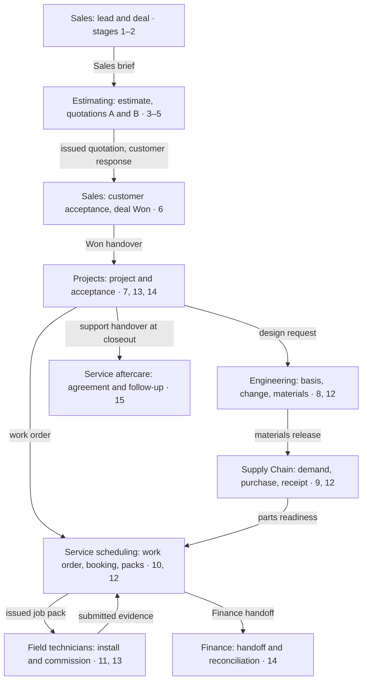

# TS-01 — Berry farm fertigation and control system

| Field | Value |
| --- | --- |
| Title and ID | Berry farm fertigation and control system — TS-01 (PPO-TS-01) |
| Type | Test specification (end-to-end business scenario) |
| Status | Draft |
| Owner | Dean Fiedler, prototype owner |
| Review | Not yet reviewed |
| Scope | Powerplants One prototype: CRM, Estimating, Projects, Engineering, Supply Chain, Service, Finance |
| Repository path | `docs/testing/TS-01-berry-farm-fertigation-project.md` |
| Versioning | Living specification under PPO-STD-001 section 7.1: Git history, no rNN suffix |
| Sources | BP-01 section 6 journeys; `docs/testing/acceptance-scenarios.csv` (AT-01 to AT-38); `docs/testing/README.md` case fields |

The TS-01 ID and filename follow PPO-STD-001 sections 6.1, 6.3 and 9.1. Dean accepted the recommendation on 30 October 2026 to declare TS as a new catalogue for end-to-end business scenarios (Q1). Change record: r01 draft prepared 30 October 2026 at Dean's request in a Claude Docs working copy, corrected the same day after an independent review against main at fa15714, then committed here; this repository file is now the authoritative copy.

## 1. Purpose and scope

Test scenario 01 (TS-01) walks one synthetic customer through a complete Priva fertigation and control project in PPO, from first enquiry to Finance handoff and aftercare. It is the reference scenario: once Dean accepts its shape, further scenarios (parts sale, planned service, warranty and returns) copy its structure.

The planned scenarios and their run order are in the [end-to-end scenario register](end-to-end-scenarios.md).

**What it tests**

- Every departmental handover in the journey: Sales to Estimating (brief), Estimating back to Sales (quotation and customer response), Sales to Projects (Won handover), Engineering to Supply (materials release), Supply to Service scheduling (parts readiness), Service to the field (job pack), field to Service review (submitted evidence), Service to Finance (one handoff per work order) and Projects to Service aftercare (support handover).
- That each handover names its source and version, receiving owner, scope, evidence, open issues and an accepted or returned outcome (BP-01 section 6.7).
- That approvals, issued revisions, acknowledgements and financial states stay distinct, and that retries never duplicate work or money.
- That a visit can finish while the project and its follow-up issues stay open.

**What it does not test**

- Live integrations. MYOB Acumatica, SharePoint, email and SMS are simulated or absent; no real customer, supplier or price is used.
- Calculation correctness. Expected estimate and quotation totals need an independently accepted fixture, not values copied from the app (open question Q3).
- Performance, load, accessibility certification and real-device behaviour. These have their own AT and PT cases.

**How to use it**

1. Load the synthetic data set in section 3 into a disposable environment that meets section 5.
2. Run the stages in section 6 in order, signed in as the actor each step names. Each step has an ID (for example TS01-05.03 is stage 5, step 3).
3. Record the actual result, evidence and any defect against the step ID in the results log (section 11).
4. Run the exception tests in section 7 as branches from the step they name, on a fresh copy of the data where the branch changes state.
5. Stop and log a defect when a step fails a pass criterion that later steps depend on. Do not work around it by editing data directly.

A step passes only when its observable result matches. An action that was attempted, or a message that says Sent, is not a pass.

## 2. Scenario narrative

Bellbird Ridge Berries — Synthetic wants automated fertigation and irrigation control installed and commissioned before autumn planting in March 2027. All people, places and figures below are fictional.

**The customer.** A family-owned commercial grower with 4.2 ha of table-top strawberries under tunnels and 2.0 ha of potted blueberries. Today they mix nutrients by hand into two stock tanks and dose through venturi injectors on timers. EC and pH drift through the day, and the farm manager checks drain by hand twice a week.

**The enquiry.** On Monday 2 November 2026 the farm manager, Priya Nandakumar (synthetic), fills in the Powerplants website enquiry form. She asks for a quote on "an automatic fertigation system with EC and pH control for 14 irrigation valves, drain monitoring and remote access from my phone". She mentions a budget of about $135,000 ex GST and a hard deadline: the system must be running by Friday 12 March 2027.

**What Powerplants proposes.** After a site visit, Sales hands a brief to Estimating. The estimator configures a Priva fertigation unit with three dosing channels plus acid, a Priva process computer controlling 14 irrigation valves in two crop zones, EC and pH sensors with a drain measurement station, and remote access. Installation, programming, commissioning and grower training are included. A first-year maintenance agreement is offered as an option.

**How it unfolds.**

1. The quotation goes through internal review and is issued. Priya asks for one change: drop the drain station from the first stage to save cost. Estimating issues revision B.
2. The owner, Graham Holt (synthetic), accepts revision B in writing on Thursday 14 January 2027 with the maintenance option. Sales marks the deal Won and hands over to Projects.
3. The project manager accepts the handover, Engineering releases the design and materials list, and Supply raises purchase orders. One sensor kit arrives damaged and is returned.
4. Service scheduling books a two-technician crew for a five-day installation from Monday 22 February 2027. Job packs are issued and acknowledged.
5. On day 3 the crew finds the existing mains pressure is lower than the design basis. This raises a site issue, an engineering query and a priced variation for a booster pump. Graham approves it the next day and the pump arrives on 2 March.
6. On a second visit on 4 and 5 March the crew fits the booster pump and commissions the system; 10 of 11 tests pass. The valve 9 flow test fails and needs a return visit. The grower accepts stage 1 with that item outstanding.
7. The return visit fixes valve 9, the outstanding item closes, the project closes out and Finance receives a reconciled handoff. The maintenance agreement starts and the site moves to aftercare.

This path exercises a customer-requested revision, a supplier return, a field discovery, a variation, a failed test, a partial acceptance and a return visit. Section 7 adds branches that the main path does not cover.

## 3. Synthetic data set

Every record is entered through PPO during the run, not loaded into the database, so the entry screens are tested too. PPO assigns readable references (SYN-…; older seeded records keep SYN-PPO-…) at creation; the tester records each one in the results log.

**Customer, site and contacts**

| Item | Value |
| --- | --- |
| Customer | Bellbird Ridge Berries — Synthetic |
| Legal entity | Bellbird Ridge Berries Pty Ltd — Synthetic (no ABN; test leaves it blank) |
| Selling company | Powerplants Australia (synthetic company context) |
| Site | Bellbird Ridge farm — Synthetic, 7 Example Road, Synthetic Valley QLD |
| Primary contact | Priya Nandakumar (synthetic), farm manager, technical contact, mobile 0400 000 001 |
| Approver | Graham Holt (synthetic), owner, signs commercial documents |
| Accounts contact | Mia Holt (synthetic), accounts, receives invoices only |
| Lead source | Website enquiry form |

**Crop zones and existing equipment**

| Zone | Crop | Area | Irrigation valves | Existing control |
| --- | --- | --- | --- | --- |
| Zone A | Table-top strawberries under tunnels | 4.2 ha | 10 (valves 1–10) | Timers, venturi injectors |
| Zone B | Potted blueberries | 2.0 ha | 4 (valves 11–14) | Timers, venturi injectors |

Other site facts: a 20,000 L header tank blended from a bore and the mains, an existing irrigation pump in the pump shed, two existing 1,000 L stock tanks, and single-phase and three-phase power in the shed.

**Priva design inputs**

The estimator enters these in the Fertigation workbench, and Engineering uses them as the design basis. They are synthetic values checked against published guidance on 30 October 2026 (sources below). Valve flows and unit sizing still need a Powerplants fertigation specialist before TS-01 is shown to staff as a realistic example (Q4).

| Input | Zone A strawberries | Zone B blueberries |
| --- | --- | --- |
| Substrate | Coir grow bags on table-tops | Coir and peat in 50 L pots |
| Stock channels used | A, B, acid | A, B, C (ammonium sulphate), acid |
| Target supply EC (mS/cm) | 1.0 | 0.9 |
| Target supply pH | 5.8 | 5.7 |
| Valves and flow (m³/h each) | 10 at 4.0 | 4 at 3.0 |
| Valves running at once | Up to 2 across both zones; peak flow 8.0 m³/h |  |

| Water source | EC (mS/cm) | pH | Bicarbonate (mmol/L) | Sodium (mmol/L) | Chloride (mmol/L) |
| --- | --- | --- | --- | --- | --- |
| Bore | 0.62 | 7.4 | 3.2 | 2.1 | 2.4 |
| Mains | 0.25 | 7.8 | 1.1 | 0.9 | 1.0 |

Pump duty: the fertigation unit must be rated for at least 10 m³/h and needs at least 3.0 bar at its outlet at 8.0 m³/h. The farm's records say the existing pump gives 3.5 bar at 8.0 m³/h, which becomes the design basis. On day 3 of installation the crew measures 2.4 bar at 8.0 m³/h, which triggers variation V-01.

**Source check, 30 October 2026**

| Input | TS-01 value | Published guidance | Result |
| --- | --- | --- | --- |
| Strawberry supply EC and pH | 1.0 mS/cm, pH 5.8 | Nutrient solution EC 1.0 dS/m (= mS/cm) or less; pH 5.5–6.0 ([University of Arizona](https://cales.arizona.edu/strawberry/Hydroponic_Strawberry_Information_Website/Irrigation.html)) | Matches; the earlier 1.4–1.6 was lowered |
| Blueberry supply EC and pH | 0.9 mS/cm, pH 5.7 | Australian potted southern highbush trial fed 0.88 dS/m at pH 5.7, within a guideline of 1.0 dS/m or less ([DPIRD case study](https://dpird-web.matrix.squiz.cloud/agriculture/water/clean-coastal-catchments/fertiliser-stewardship-group/fsg-insights/soilless-bb-management)) | Matches; the earlier 1.2 and pH 5.2 were changed |
| Bore bicarbonate | 3.2 mmol/L | 0.2–0.5 mmol/L should enter the irrigation unit; high-bicarbonate water needs acid injection ([Priva support](https://support.priva.com/hc/en-us/articles/18550321515420-Why-is-the-pH-level-at-the-plants-so-high)) | Consistent: justifies the acid channel |
| Fertigation unit | 10 m³/h, 3 nutrient channels + acid | NutriJet in-line 3–80 m³/h, 1–10 dosing channels ([Priva NutriJet leaflet](https://www.priva.com/media/mqtenrx1/en-leaflet-nutrijet-202312-online.pdf)) | Within range; the actual model choice is for a specialist |
| Valve flow, 4.0 m³/h per strawberry valve | About 0.42 ha per valve | Depends on dripper type and spacing, not set here | Specialist to confirm |

**Scope lines**

At run time, map each line to a synthetic product in the PPO catalogue and record the product ID. Quantities and unit prices are the proposed price fixture (Q3).

| # | Line | Qty | Unit | Unit price ex GST | Rev A ex GST | Rev B ex GST | Notes |
| --- | --- | --- | --- | --- | --- | --- | --- |
| 1 | Priva fertigation unit, 3 nutrient channels + acid | 1 | each | $58,500.00 | $58,500.00 | $58,500.00 | Configured in the Fertigation workbench |
| 2 | Priva process computer with irrigation module | 1 | each | $24,800.00 | $24,800.00 | $24,800.00 | Controls 14 valves in 2 zones |
| 3 | EC and pH sensor set | 2 | set | $2,350.00 | $4,700.00 | $4,700.00 | One set arrives damaged (stage 9) |
| 4 | Drain measurement station | 1 | each | $9,200.00 | $9,200.00 | Removed | Customer-requested change |
| 5 | Irrigation solenoid valve with wiring | 14 | each | $640.00 | $8,960.00 | $8,960.00 |  |
| 6 | Stock tank 1,000 L with mixer | 2 | each | $1,850.00 | $3,700.00 | $3,700.00 | Tanks C and acid; A and B reuse existing tanks |
| 7 | Remote access licence, 12 months | 1 | each | $1,450.00 | $1,450.00 | $1,450.00 |  |
| 8 | Installation labour, 2 technicians × 5 days × 8 h | 80 | hour | $135.00 | $10,800.00 | $10,800.00 |  |
| 9 | Programming, commissioning and grower training | 1 | lot | $14,600.00 | $14,600.00 | $14,600.00 |  |
| 10 | Freight and site establishment | 1 | lot | $2,400.00 | $2,400.00 | $2,400.00 |  |
| 11 | First-year maintenance agreement (option) | 1 | year | $4,800.00 | Option | Option | Accepted with rev B (stage 6) |
| V-01a | Booster pump | 1 | each | $3,950.00 |  |  | Variation V-01 (stage 12) |
| V-01b | Pressure switch and fittings | 1 | lot | $420.00 |  |  | Variation V-01 |
| V-01c | Booster pump installation labour | 6 | hour | $135.00 |  |  | Variation V-01 |

**Expected totals**

| Figure | Ex GST | GST 10% | Inc GST |
| --- | --- | --- | --- |
| Rev A, base scope (lines 1–10) | $139,110.00 | $13,911.00 | $153,021.00 |
| Rev B, base scope (lines 1–10 less line 4) | $129,910.00 | $12,991.00 | $142,901.00 |
| Rev B with the maintenance option, as accepted | $134,710.00 | $13,471.00 | $148,181.00 |
| Variation V-01 | $5,180.00 | $518.00 | $5,698.00 |
| Contract value after V-01 | $139,890.00 | $13,989.00 | $153,879.00 |

These totals were calculated outside PPO as quantity × unit price, with GST at 10% of the ex-GST amount. The project value without the agreement, which is billed under the agreement, is $135,090.00 ex GST, $13,509.00 GST, $148,599.00 inc GST. They test arithmetic, revision and option handling only. They are not Powerplants or Priva prices, and PPO's cost-source and margin rules may need them entered as costs rather than sell prices (Q3).

**Key dates**

| Date | Event | Record created or changed |
| --- | --- | --- |
| Monday 2 November 2026 | Website enquiry received | Lead |
| Wednesday 11 November 2026 | Sales site visit | Activity on the deal |
| Friday 4 December 2026 | Quotation revision A issued | Quotation, rev A |
| Friday 18 December 2026 | Quotation revision B issued | Quotation, rev B |
| Thursday 14 January 2027 | Graham accepts rev B with the maintenance option; deal Won | Customer response; Won handover |
| Monday 18 January 2027 | Project manager accepts the handover | Project |
| Friday 29 January 2027 | Engineering releases the design and materials list | Design release; material release |
| Monday 1 February 2027 | Purchase orders raised | Purchase orders |
| Monday 8 February 2027 | Goods received; one sensor set damaged and returned | Receipt; supplier return |
| Tuesday 16 February 2027 | Replacement sensor set received | Receipt |
| Monday 22 to Friday 26 February 2027 | APT-1: installation, 2 technicians | Appointment; job packs |
| Wednesday 24 February 2027 | Low pump pressure found; V-01 raised | Site issue; engineering query; variation |
| Thursday 25 February 2027 | Graham approves V-01; booster pump ordered | Variation decision; purchase order |
| Tuesday 2 March 2027 | Booster pump received | Receipt |
| Thursday 4 to Friday 5 March 2027 | APT-2: booster pump fitted, commissioning; valve 9 fails; stage 1 accepted with one outstanding item | Appointment; commissioning results; stage acceptance |
| Wednesday 10 March 2027 | APT-3: return visit fixes valve 9 | Appointment; retest |
| Friday 12 March 2027 | Customer's deadline; closeout, Finance handoff, maintenance agreement starts | Closeout; Finance handoff; agreement |

These are the story's dates. PPO refuses future times for anything it timestamps, so the time-compression rule in section 5 decides what is entered during a run.

## 4. Actors

The tester plays every staff role by switching between the synthetic profiles PPO seeds locally: account control, Change identity, choose from Identity, then Use this identity (on a phone, the tab bar's More). Switching clears what is on screen, which is expected.

| Role in the scenario | PPO profile to use | Main duties exercised |
| --- | --- | --- |
| Sales representative | Coordinator | `crm.lead.*`, `crm.opportunity.*`; prepares the Sales brief and Won handover |
| Estimator | Coordinator | `estimating.edit`, `estimating.quote.prepare`; receives the brief, builds the estimate, prepares quotations, records customer responses |
| Estimate reviewer | Synthetic source evidence reviewer | `estimating.review.completeness`, `.price`, `.technical`, `estimating.source.review` |
| Quotation approver | Synthetic quotation approver | `estimating.quote.approve` |
| Quotation issuer | Synthetic quotation issuer | `estimating.quote.issue` |
| Products author, reviewer, publisher | Synthetic Products author / reviewer / publisher | Only if a scope line has no synthetic catalogue product (section 5) |
| Project manager | Coordinator | `project.*`, `most acceptance.* duties`, `schedule.request`; receives the Won handover |
| Design engineer | Sam Jordan — materials engineer; Alex Lee — materials author | Engineering basis, queries, drawings, materials list |
| Technical reviewer | Casey — technical reviewer | Reviews basis, materials release, changes and commissioning basis; records acceptance technical decisions and validates customer responses (acceptance.technical, acceptance.response.validate) |
| Material release authority | Drew — material release authority | Authorises and issues the materials release, drawings and commissioning release; records change decisions |
| Supply Chain coordinator | Robin — Supply Chain coordinator, then Coordinator | Robin receives the release (`engineering.material.receive`); Coordinator runs `supply.coordinate`, `.inspect`, `.fulfil`, `.return` |
| Scheduler, job pack preparer and checker, report reviewer | Coordinator | `schedule.manage`, `schedule.contact`, `pack.prepare`, `pack.check`, `pack.issue`, `report.review`, `report.issue` |
| Lead technician | Riley — assigned technician | `pack.acknowledge`, `field.*.own` |
| Second technician | Morgan — assigned technician | `pack.acknowledge`, `field.*.own` |
| Commissioning verifier | Taylor — commissioning verifier | Records commissioning results and retest |
| Service coordinator (support receiving) | Jamie — Service coordinator | Records independent Service receiving at handover |
| Finance preparer, reviewer, processor, reconciler | Finance preparer / reviewer / processor / reconciler | `finance.prepare`, `.review`, `.process`, `.reconcile`; the reviewer also approves the maintenance agreement and records commercial disposition |
| People without access (negative tests) | Observer; Technician — assignment unavailable; Company B | Must be refused (TS01-X16) |

The customer's people (Priya, Graham, Mia) are not PPO users. Staff record their responses, as PPO sends nothing to customers.

The Coordinator profile plays Sales, Estimating, project manager and scheduler. So this run cannot show separation between those roles; it can only show the separations PPO enforces with distinct profiles (estimate review, approval, issue, engineering release, Finance). This is finding F-05 in section 8.

## 5. Preconditions and test environment

Run TS-01 locally against a disposable synthetic database, not the hosted demo. The hosted demo's tester roles have no Projects, Engineering, Supply, field, report, Finance, review, approval or issue authority, so most stages would be refused there (finding F-07).

**Environment**

| Item | Requirement | Record in the results log |
| --- | --- | --- |
| Code | `main` of `deanrfiedler-gif/powerplants-one`; checked at `fa15714` on 30 October 2026 | Exact commit SHA used |
| Database | Disposable PostgreSQL with synthetic data only. With the app stopped and `.env.local` set, run `npm run db:reset` (it migrates and seeds; it refuses unless `PPO_ALLOW_RESET=dispose-synthetic` and `PPO_RESET_DATABASE` are set), then `npm run db:health` | Health result and time |
| Application | `npm run dev`, opened at `http://127.0.0.1:3000` | Start time |
| Company | Company A, "SYN Greenhouse Demonstration" | — |
| Desktop browser | Chromium at 1440 × 900 for office roles | Browser and version |
| Phone viewport | 390 × 844 for Riley and Morgan in stages 11 and 13 | Device or emulation used |
| Integrations | None live. ERP outcomes, quotation distribution and customer messages are simulated | — |

**Entry checks before stage 1**

- [ ] Every profile in section 4 appears in the Identity list.
- [ ] Each duty named in section 4 is granted to its profile; check under Admin, Access. A missing grant is logged before the run, not discovered mid-stage.
- [ ] A published synthetic catalogue product exists for each scope line in section 3. Create and publish any that are missing with the Products author, reviewer and publisher profiles, and record their IDs.
- [ ] Reviewed cost sources exist for lines 1–10, 11 and V-01a–c at the section 3 unit prices, or the estimator enters them as manual lines (Q3).
- [ ] No customer named Bellbird Ridge Berries exists yet.
- [ ] Evidence folder created for this run, named `TS-01-run-<UTC timestamp>-01` per PPO-STD-001 section 11.3.

**Time compression**

The story runs from November 2026 to March 2027, but PPO refuses future times for anything it timestamps or checks against now: customer responses, receipts, approvals and field time. So every event is recorded at run time, in stage order, with the scenario date in the note or reason. Field time is real: Start work starts each technician's timer, labour is the timer's elapsed intervals, and the timer must be finished before a visit is submitted. Run timers briefly, record the actual minutes beside the scenario hours (APT-1 80 h, APT-2 32 h of which 6 h is V-01, APT-3 4 h) in the results log, and check Finance quantities against the reviewed reports, not against fixed numbers. Book appointments on the run date and record the date mapping in the results log. Planned dates that PPO only stores (requested dates, programme tasks, agreement start) use the scenario dates. Q5 asks whether a clock-controlled environment is wanted later.

## 6. Stage-by-stage steps

The main path has 15 stages. Each stage gives its entry criteria, numbered steps, exit criteria and links. A step names the profile to use, the PPO page, the action, the observable result that counts as a pass, and what to do if it fails. Steps marked **Not testable yet** cover behaviour PPO does not have a screen for today; record them as Not testable yet, never as passed or failed. At every handover step, also check that the record shows its source and version, receiving owner, scope, evidence, open issues and outcome (BP-01 section 6.7); a missing field is S3.

References in expected results use PPO's current format for new records, `SYN-<code>-nnnnnn` (for example `SYN-OPP-000123`). Older seeded records keep `SYN-PPO-…`.

Every handover is a named record the receiver accepts or returns. TS-01 journey: 9 functions, 11 handovers.

Projects coordinates the middle of the journey; field work runs through a Service work order, and Finance receives one handoff per work order.

### Stage 1 — Enquiry captured as a lead (scenario date 2 November 2026)

**Entry criteria:** section 5 entry checks complete; no Bellbird customer exists.

| Step | Profile | Page | Action | Pass when | If it fails |
| --- | --- | --- | --- | --- | --- |
| TS01-01.01 | Coordinator | `/sales/leads` | Add lead: Bellbird Ridge Berries — Synthetic, Priya Nandakumar, mobile, source channel Other, note "Website enquiry form" with Priya's enquiry text | Lead saved in New with a `SYN-LEAD-` reference; source and note shown | S2; stop |
| TS01-01.02 | Coordinator | `/sales/leads/[id]` | Record lead note of the first call; move the lead to Contacting | Note in history with server time; state Contacting | S3; continue |
| TS01-01.03 | Coordinator | `/sales/leads/[id]` | Plan next activity: call Priya to book the site visit, due 4 November 2026 | Activity shows owner and due date, and appears in My Work | S3; continue |
| TS01-01.04 | Coordinator | `/sales/leads/[id]` | Save customer context: create the customer and site and link Priya; then add Graham and Mia with their roles on the customer record (/customers/[id]) | Customer `SYN-ORG-` and site `SYN-SITE-` created once; contacts show roles | S2; stop |
| TS01-01.05 | Coordinator | `/sales/leads/[id]` | Qualify and convert lead | Lead Converted; one deal `SYN-OPP-` at stage Discovery, outcome Open, linked to the customer, site and lead | S1 if two deals; otherwise S2; stop |

**Exit criteria:** lead Converted; exactly one Open deal at Discovery linked to the customer and site.

**Links:** LC-11, LC-12 (`docs/contracts/lead-to-delivery-continuity.md`); AT-25, AT-30. Branch TS01-X01. Finding F-06: there is no Website source channel.

### Stage 2 — Deal qualified and site visited (scenario date 11 November 2026)

**Entry criteria:** stage 1 exit met.

| Step | Profile | Page | Action | Pass when | If it fails |
| --- | --- | --- | --- | --- | --- |
| TS01-02.01 | Coordinator | `/sales/opportunities/[id]` | Plan next activity: site visit with Priya, 11 November 2026 | Activity listed on the deal with owner and date | S3; continue |
| TS01-02.02 | Coordinator | `/sales/opportunities/[id]` | Complete the site visit activity with notes: two zones, 14 valves, pump shed, farm-stated 3.5 bar, bore and mains supply | Activity completed; notes in deal history | S3; continue |
| TS01-02.03 | Coordinator | `/sales/opportunities/[id]` | Change deal stage from Discovery to Scoping; then try to move straight to Closing | Scoping saved; the jump to Closing is refused (one stage forward at a time) | S2 if the jump is allowed |
| TS01-02.04 | Coordinator | `/sales/opportunities/[id]` | Try Record outcome Won while at Scoping | Refused: Won is allowed only at Closing; outcome stays Open | S1: control bypassed |

**Exit criteria:** deal Open at Scoping with the site visit completed.

**Links:** `src/crm/stages.ts`; migration 0023 (owned outcomes); AT-25.

### Stage 3 — Sales brief accepted by Estimating

**Entry criteria:** stage 2 exit met.

| Step | Profile | Page | Action | Pass when | If it fails |
| --- | --- | --- | --- | --- | --- |
| TS01-03.01 | Coordinator (as Sales) | `/sales/handoffs/estimating` | Save draft brief from the deal. Problem and outcome from section 2; included scope = lines 1–11; exclusions = civil works, power to the shed, bore pump; assumption = pump gives 3.5 bar at 8.0 m³/h (farm records); unknown = Zone B valve flow; requested date 4 December 2026 with reason; site and existing assets; evidence = site visit notes; destination Projects | Draft saved with every field shown back | S2; stop |
| TS01-03.02 | Coordinator (as Sales) | `/sales/handoffs/estimating/[id]` | Submit exact revision to the named receiving owner | State Submitted; revision 1 frozen; brief appears in `/estimating/intake` | S2; stop |
| TS01-03.03 | Coordinator (as estimator) | `/estimating/intake` | Request clarification: "Confirm Zone B valve flow rate" | State ClarificationRequested; the question shows on the Sales side | S3; continue |
| TS01-03.04 | Coordinator (as Sales) | `/sales/handoffs/estimating/[id]` | Answer clarification: 3.0 m³/h per valve | State ClarificationAnswered | S3; continue |
| TS01-03.05 | Coordinator (as estimator) | `/estimating/intake` | Resolve reviewed answer; Accept exact revision | State Accepted with server time; the accepted revision can no longer be edited, only succeeded | S2; stop |
| TS01-03.06 | Coordinator (as estimator) | `/sales/handoffs/estimating/[id]` | Link accepted Sales brief | Opens `/estimating/discovery/new` for this deal, showing its `SYN-OPP-` reference | S2; stop |

**Exit criteria:** brief Accepted at an exact revision; a Discovery workspace is started for the deal.

**Links:** ADR-0046; LC-13; BP-01 section 6.7. Branches TS01-X02 (brief returned) and TS01-X17 (same person sends and receives).

### Stage 4 — Fertigation scoped, estimate built and reviewed (by 4 December 2026)

**Entry criteria:** stage 3 exit met; reviewed cost sources available (section 5).

The Fertigation workbench produces scoping notes, not priced lines: its parts proposal into CPQ is a proposed contract only (finding F-01). So the estimator scopes the system in the workbench, then enters the priced lines in a manual estimate.

| Step | Profile | Page | Action | Pass when | If it fails |
| --- | --- | --- | --- | --- | --- |
| TS01-04.01 | Coordinator (as estimator) | `/estimating/discovery/[id]` | Work through Requirements, Configuration (equipment family Fertigation) and Scope & delivery; save the alternative "Full scope" | Discovery workspace saved against the deal; scope readiness Complete | S2; stop |
| TS01-04.02 | Coordinator | `/estimating/fertigation/new` | Create saved scope from the saved Discovery alternative | Fertigation scope `SYN-FRT-` created, Active, linked to the deal | S2; stop |
| TS01-04.03 | Coordinator | `/estimating/fertigation/[id]`, Growing areas & irrigation | Enter zones A and B, production context commercial berries, drip application, 14 valves with their flows, up to 2 valves at once | Saved revision shows 14 valves and a peak flow of 8.0 m³/h | S2; continue |
| TS01-04.04 | Coordinator | Water & hydraulics | Enter bore and mains with the section 3 samples, the 20,000 L header tank and the pump at 3.5 bar at 8.0 m³/h | Saved; samples show EC in mS/cm and pH; pump duty shown with units | S3; continue |
| TS01-04.05 | Coordinator | Recipes & dosing; Controls & I/O | Enter the two zone recipes, stocks A, B, C and acid, four dosing channels, EC and pH sensors; choose a Connext controller and a candidate fertigation unit | Saved; controller outputs cover 14 valves plus sensors, or any shortfall is shown, never hidden. Record the candidate chosen and any warnings | S2 if a shortfall is hidden |
| TS01-04.06 | Coordinator | Review | Prepare the scoping handover; review the receiving effect; receive it into Discovery | Discovery shows "Accepted fertigation scoping notes" tied to the exact scope revision | S2; stop |
| TS01-04.07 | Coordinator | `/estimating/new` | Create the estimate for the deal: lines 1–10 and option 11 at the section 3 quantities and prices, each with its product ID and cost source | Estimate `SYN-EST-` shows $139,110.00 ex GST for lines 1–10 and the $4,800.00 option separately (if PPO has no separate option line, log S3); any GST shown is separate and equals 10% | S1 if any figure differs once Q3 signs off the fixture; S3 until then |
| TS01-04.08 | Synthetic source evidence reviewer | `/estimating/estimates/[id]/sources` | Review the cost sources the estimate uses | Each source shows Reviewed with reviewer and time | S2; stop |
| TS01-04.09 | Coordinator | `/estimating/estimates/[id]/review` | Submit for review; then try to record the Completeness review yourself | Submitted, and the estimate appears in `/estimating/reviews`. The owner's own review is refused. Coordinator holds no review duty, so this shows a missing-duty refusal, not the author rule; capture the message | S1 if the owner can review |
| TS01-04.10 | Synthetic source evidence reviewer | `/estimating/estimates/[id]/review` | Record Completeness, SourcePrice and Technical as Reviewed, one at a time | The estimate shows Reviewed only after the third decision | S2; stop |

**Exit criteria:** fertigation scope received into Discovery; estimate Reviewed at $139,110.00 ex GST plus the option.

**Links:** `docs/contracts/estimating-review.md`; `docs/decisions/estimating-configurator-model.md` (CM11); `docs/contracts/workbench-parts-proposal.md` (proposed); AT-04, AT-26; EA-03, EA-09, EA-12, EA-14.

### Stage 5 — Quotation revision A issued, changed and replaced by revision B (4–18 December 2026)

**Entry criteria:** stage 4 exit met.

| Step | Profile | Page | Action | Pass when | If it fails |
| --- | --- | --- | --- | --- | --- |
| TS01-05.01 | Coordinator | `/estimating/quotes/[id]` | Create the draft quotation from the reviewed estimate; check wording, option line, exclusions and the pressure assumption | Draft `SYN-QUO-` shows all lines, the option, exclusions and assumption; the customer view shows no cost or margin | S1 if cost or margin is visible |
| TS01-05.02 | Coordinator | `/estimating/quotes/[id]/release` | Prepare | Prepared; requires the estimate's three reviews | S2; stop |
| TS01-05.03 | Synthetic quotation approver | `/estimating/quotes/[id]/release` | Approve | Approved, showing approver and time; authority limits shown as Not configured | S2; stop |
| TS01-05.04 | Synthetic quotation issuer | `/estimating/quotes/[id]/release` | Issue, then Distribution | Issued (rev A in this document) with the exact issued file retained; distribution shows SimulatedDelivered, never Sent to a real address | S1 if a real message is sent |
| TS01-05.05 | Coordinator | `/sales/opportunities/[id]` | Change deal stage Scoping to Quoting | Stage Quoting with history | S3; continue |
| TS01-05.06 | Coordinator | `/estimating/quotes/[id]/response` | Record response: Negotiation, "remove the drain station from stage 1", from Priya | Response recorded against rev A; acceptance held until a successor issue | S2; stop |
| TS01-05.07 | Coordinator | `/sales/opportunities/[id]` | Change deal stage Quoting to Negotiation | Stage Negotiation | S3; continue |
| TS01-05.08 | Coordinator, then source reviewer | Estimate and review pages | Create a successor estimate without line 4; submit; reviewer records the three reviews | Successor Reviewed at $129,910.00 ex GST; the rev A estimate is unchanged | S1 if rev A changes |
| TS01-05.09 | Coordinator, approver, issuer | `/estimating/quotes/[id]/release` | Prepare, approve and issue the successor | Rev B issued; rev A stays readable as superseded with its original file | S1 if rev A's file changes |

**Exit criteria:** rev B issued at $129,910.00 ex GST plus the $4,800.00 option; rev A retained unchanged.

**Links:** `docs/contracts/quotation-release.md`; AT-03, AT-36. Branches TS01-X03 and TS01-X04.

### Stage 6 — Customer accepts, deal Won, Projects receives (14–18 January 2027)

**Entry criteria:** stage 5 exit met.

| Step | Profile | Page | Action | Pass when | If it fails |
| --- | --- | --- | --- | --- | --- |
| TS01-06.01 | Coordinator | `/estimating/quotes/[id]/response` (rev B) | Record response: Accepted by Graham Holt in writing, with no conditions; note in the reason that the maintenance option is taken | Accepted against the exact rev B issue. The response carries no condition or hold, so Won and conversion can proceed (Q6) | S2; stop |
| TS01-06.02 | Coordinator | `/sales/opportunities/[id]` | Change stage Negotiation to Closing; Record outcome Won with the accepted rev B response as evidence | Outcome Won; evidence points to the exact rev B issue; history shows the time | S2; stop |
| TS01-06.03 | Coordinator (as Sales) | `/sales/handoffs/won` | Prepare the Won handover: destination Projects, accepted scope rev B plus option, assumption 3.5 bar at 8.0 m³/h, requested completion 12 March 2027 with reason, project manager as receiving owner; Submit exact revision | Submitted at revision 1 | S2; stop |
| TS01-06.04 | Coordinator (as project manager) | `/sales/handoffs/won/[id]` | Accept exact revision | Accepted with time | S2; stop |
| TS01-06.05 | Coordinator | `/projects/new` (opened from the handover) | Create native project "Bellbird Ridge — fertigation and control, stage 1" with customer, site and dates | Project `SYN-PRJ-` saved: status Planned, lifecycle Active | S2; stop |
| TS01-06.06 | Coordinator | `/sales/handoffs/won/[id]` | Link accepted Won handover, with a delivery link reason | Shows "Current accepted handover linked"; the project's Sales source shows the deal and rev B; exactly one project exists | S1 if two projects |
| TS01-06.07 | Coordinator | `/estimating/quotes/[id]/conversion` | Receive the conversion; resolve each line; plan; execute | Forecast-class Supply demands exist for the lines; no reservation, purchase or project is created by conversion | S1 if stock is reserved or bought |

**Exit criteria:** deal Won on rev B; Won handover accepted and linked to one project; forecast demand recorded.

**Links:** LC-15, LC-16; `docs/decisions/won-delivery-continuity.md`; `docs/decisions/deal-outcome-evidence.md`; AT-05. Branches TS01-X05, TS01-X06, TS01-X18.

### Stage 7 — Project set up (18 January 2027)

**Entry criteria:** stage 6 exit met.

| Step | Profile | Page | Action | Pass when | If it fails |
| --- | --- | --- | --- | --- | --- |
| TS01-07.01 | Coordinator (as project manager) | `/projects/[id]` | Add programme tasks: engineering release 29 January, procurement 1–16 February, installation 22–26 February, commissioning 4–5 March, closeout 12 March 2027 | Schedule shows the five tasks with dates and dependencies | S2; continue |
| TS01-07.02 | Coordinator | `/projects/[id]` | Change status from Planned to InProgress | Status InProgress with history | S3; continue |
| TS01-07.03 | Coordinator | `/projects/programme` | Find the project in the programme view | Listed with its dates | S3; continue |
| TS01-07.04 | Coordinator | `/projects/commercial` | Record the commercial basis (rev B plus option) and two obligations: grower training before handover, 12-month remote access | **Not testable yet**: backend only, no page, and no seeded profile holds the `project.commercial.*` duties (F-03) | Record Not testable yet |

**Exit criteria:** project InProgress with its programme. The accepted PJ-02 project record design (Overview, Schedule, Acceptance, Files, History) is not built, so the older schedule page is tested (F-04).

**Links:** `docs/contracts/project-commercial-controls.md`; AT-09, AT-38.

### Stage 8 — Engineering basis, drawings and materials released (by 29 January 2027)

**Entry criteria:** stage 7 exit met.

If a profile is refused a step below for lack of a duty, use the profile PPO permits, record both, and log S3 against section 4.

| Step | Profile | Page | Action | Pass when | If it fails |
| --- | --- | --- | --- | --- | --- |
| TS01-08.01 | Coordinator, then Sam Jordan — materials engineer | `/engineering` | Coordinator creates the engineering package for the project (only Coordinator holds engineering.create), disciplines Hydraulics and Controls, assigned to Sam | Package `SYN-ENG-` linked to the project; state Queued, then In design | S2; stop |
| TS01-08.02 | Sam Jordan | `/engineering/[id]/basis` | Record requirements (14 valves, 2 recipes, peak 8.0 m³/h), the assumption "pump gives 3.5 bar at 8.0 m³/h, from farm records, not measured", interfaces (power, header tank) and the fertigation scope revision as source; Submit | Basis Submitted; the pressure assumption is listed as an assumption, not a verified fact | S2; continue |
| TS01-08.03 | Casey — technical reviewer | `/engineering/[id]/basis/review` | Review the basis | Reviewed by Casey; the author cannot review their own basis | S1 if the author can review |
| TS01-08.04 | Sam Jordan | `/engineering/[id]/drawings/deliverables` | Sam prepares the hydraulic schematic and control wiring schedule; Drew — material release authority issues them (engineering.technical.issue) | Both Issued with a revision and issue time | S2; continue |
| TS01-08.05 | Alex Lee — materials author | `/engineering/[id]/materials` | Draft the materials list from the rev B scope, mapped to catalogue products; Submit | Submitted; no drain station; quantities match section 3 | S2 if the drain station appears |
| TS01-08.06 | Casey | `/engineering/[id]/materials/releases` | Technical review | TechnicallyReviewed | S2; stop |
| TS01-08.07 | Drew — material release authority | `/engineering/[id]/materials/releases` | Prepare, Authorise, Issue | Issued with Drew recorded as the authority | S2; stop |
| TS01-08.08 | Alex Lee, then Robin — Supply Chain coordinator | `/engineering/[id]/materials/handover` | Coordinator (as Supply) first records each line's demand as Approved, origin Project, with authority evidence at /supply/material-readiness. Then Alex prepares the handover to Supply (AwaitingReceiver) and Robin accepts it | Accepted by Robin with time; the release revision is named on the acceptance. A technical release alone never turns forecast demand into approved demand | S2; stop |

**Exit criteria:** basis Reviewed; drawings Issued; materials release Issued and accepted by Supply.

**Links:** ADR-0047; AT-15, AT-37. Branch TS01-X13.

### Stage 9 — Parts bought, received, one set returned (1–16 February 2027)

**Entry criteria:** stage 8 exit met.

| Step | Profile | Page | Action | Pass when | If it fails |
| --- | --- | --- | --- | --- | --- |
| TS01-09.01 | Coordinator (as Supply) | `/supply/material-readiness` | Check each released line's Approved demand (origin Project) from TS01-08.08 | One Approved demand per line; with nothing allocated, each shows a shortage (Blocked or At risk), not Ready | S2 if any line shows Ready |
| TS01-09.02 | Coordinator | `/supply/purchasing` | Record a purchase and a supplier-confirmed promise for each line, due 8 February 2027; register the inbound supply at /supply/shipments | Purchase and Promise recorded with simulated ERP outcome; no line shows Ready before receipt | S2; continue |
| TS01-09.03 | Coordinator | `/supply/receipts` | Record receipt on 8 February; inspect the sensor sets and quarantine one as damaged | Sensor line shows 1 usable and 1 quarantined (damage); the sensor line is not Ready; other lines unaffected | S1 if the damaged set counts as usable |
| TS01-09.04 | Coordinator | `/supply/returns` | Record a supplier return of the damaged set with the reason | Return recorded separately from the receipt; no credit is implied | S2; continue |
| TS01-09.05 | Coordinator | `/supply/receipts` | Receive the replacement set on 16 February; allocate every line to the project demand | Every line shows Ready for the stated material scope | S2; stop |

**Exit criteria:** every released line Ready; the return recorded and open with the supplier.

**Links:** ADR-0049; `docs/contracts/supply-chain-readiness.md`; `docs/decisions/supply-readiness-promise-rules.md`; AT-16, AT-29. Branch TS01-X07.

### Stage 10 — Work order, booking and job packs (by 19 February 2027)

**Entry criteria:** stage 9 exit met.

A project cannot hold appointments, job packs, reports or Finance handoffs. Field work runs on a Service work order, which needs a service request and refers to the project only by a typed reference (finding F-02).

| Step | Profile | Page | Action | Pass when | If it fails |
| --- | --- | --- | --- | --- | --- |
| TS01-10.01 | Coordinator (as project manager) | `/service/tickets/new` | Create a service request for the installation at the Bellbird site, quoting the project reference; triage it | Request `SYN-TKT-` moves New to Triaged | S2; stop |
| TS01-10.02 | Coordinator | `/service/work-orders/new` | Create the work order from the request: rev B installation scope, customer, site, project reference `SYN-PRJ-…` | Work order `SYN-WO-` in Draft; the project reference is shown | S2; stop |
| TS01-10.03 | Coordinator | `/service/work-orders/[id]` | Authorise the work order | Authorised; Authorisation-stage readiness criteria Pass | S2; stop |
| TS01-10.04 | Coordinator | `/schedule` | Propose APT-1 for Riley and Morgan (scenario dates 22–26 February; see time compression); Confirm booking | Appointment `SYN-APT-` Confirmed with both technicians and no overlap | S2; stop |
| TS01-10.05 | Coordinator | `/service/appointments/[id]` | On /supply/material-readiness, set Appointment / visit to APT-1 on each Approved demand; then open APT-1's readiness view | Parts criterion is derived from Supply as Pass and cannot be ticked by hand | S1 if it can be ticked by hand |
| TS01-10.06 | Coordinator | `/service/appointments/[id]` | Record customer contact: Priya agrees the dates. Then Record site readiness on the Customer site readiness check: access, power and water, equipment and isolation each Confirmed, with notes (needs PR #750) | Both contacts recorded with who, when and method; the site readiness check shows Confirmed (late if after the window); nothing is sent | S3; continue |
| TS01-10.07 | Coordinator | `/service/packs/new` | Prepare the job pack (scope, issued drawings, materials, safety, contacts); Record check; Issue | Pack `SYN-PACK-` Issued at an exact revision naming both technicians | S2; stop |
| TS01-10.08 | Riley, then Morgan | `/my-jobs/[id]` (phone) | Acknowledge this exact issue | Each acknowledgement recorded separately. APT-1 shows Ready to dispatch. Without PR #750 it stays Dispatch held on Customer site readiness and Start work is refused (F-08). Pack lead-time Activities may appear because the pack is issued on the run date; they are expected | S2; stop |

**Exit criteria:** work order Authorised; APT-1 Confirmed and Ready to dispatch; pack issued and acknowledged by both technicians.

**Links:** `docs/decisions/field-readiness-gate-proposal.md`; `docs/decisions/job-pack-figma-implementation.md`; AT-06, AT-07, AT-08, AT-09; PT-04, PT-05, PT-06, PT-10. Branches TS01-X07 to TS01-X10 and TS01-X12.

### Stage 11 — Installation visit APT-1 (22–26 February 2027)

**Entry criteria:** stage 10 exit met; Riley and Morgan on the phone viewport.

| Step | Profile | Page | Action | Pass when | If it fails |
| --- | --- | --- | --- | --- | --- |
| TS01-11.01 | Riley — assigned technician | `/my-jobs/[id]` | Start work | Appointment InProgress; timer Running from server time | S2; stop |
| TS01-11.02 | Riley and Morgan | `/my-jobs/[id]` | Each runs their own timer (Morgan starts work on his phone too), pausing and resuming once; each records materials fitted (unit, controller, 2 sensor sets, 14 valves, 2 tanks, unit EA) and PNG photos | Time intervals listed per person; photos stored as PNG; Morgan cannot change Riley's entries. Record actual minutes against the scenario's 80 h | S1 if one technician can change the other's entries |
| TS01-11.03 | Riley | `/my-jobs/[id]` | Day 3: record a reading of 2.4 bar at 8.0 m³/h at the pump outlet and an observation "below the 3.0 bar the design needs", with a gauge photo | Reading saved with units and visible to the office | S2; continue |
| TS01-11.04 | Riley | `/my-jobs/[id]` | Both technicians finish their timers; Riley records completion outcome Partial, reason "commissioning needs a booster pump and a second visit"; Submit exact evidence for review | Appointment CompletedPendingReview; the work order stays open. Submitting with a timer still running is refused ("Finish your work timer…") | S2; stop |
| TS01-11.05 | Coordinator (as report reviewer) | `/service/reports/[id]` | Review the report: Approved; Issue | Report `SYN-RPT-` Issued; labour equals the recorded timer intervals and materials match the captures; no internal notes in the customer copy | S1 if quantities differ or internal notes show |
| TS01-11.06 | Coordinator | `/service/reports/[id]` | Record Priya's response: AcceptedWithReservations, "pressure to be fixed before commissioning" | Response recorded against the exact report version; the reservation stays visible | S2; continue |

**Exit criteria:** APT-1 complete after review; report issued with a reservation; work order open; low pressure on record.

**Links:** AT-10 to AT-14; PT-13, PT-14, PT-15, PT-16. Branches TS01-X11, TS01-X12.

### Stage 12 — Low pressure resolved by query, change and variation (24 February – 3 March 2027)

**Entry criteria:** stage 11 exit met.

| Step | Profile | Page | Action | Pass when | If it fails |
| --- | --- | --- | --- | --- | --- |
| TS01-12.01 | Coordinator (as project manager) | `/engineering/[id]/queries` | Raise a query: "Measured 2.4 bar at 8.0 m³/h; design needs 3.0 bar. Advise." Attach the day 3 reading | Query Open, owned by Engineering, with the evidence linked | S2; stop |
| TS01-12.02 | Sam Jordan, then Coordinator | `/engineering/[id]/queries` | Sam answers: booster pump and pressure switch needed. The project manager resolves the query | Answered, then Resolved, each with person and time | S2; stop |
| TS01-12.03 | Sam Jordan, Casey | `/engineering/[id]/changes` | Raise a change: basis pressure 2.4 bar measured; add booster pump; assess impact on materials, job pack and programme; Casey reviews; Drew — material release authority records the decision (engineering.change.decide) | Change reaches DecisionRecorded; impact names the materials release and the job pack; the earlier basis stays readable | S2; stop |
| TS01-12.04 | Coordinator | `/projects/commercial` | Raise variation V-01 at $5,180.00 ex GST; assess; record Graham's approval on 25 February | **Not testable yet** (F-03). The engineering change stands in as the scope authority for the rest of this run | Record Not testable yet |
| TS01-12.05 | Alex Lee, Casey, Drew, Robin | `/engineering/[id]/materials` | Release a new materials revision adding lines V-01a and V-01b; hand it to Supply; Robin accepts | New release Issued and accepted; the first release stays unchanged | S1 if the first release changes |
| TS01-12.06 | Coordinator (as Supply) | `/supply/purchasing`, `/supply/receipts` | Purchase the booster pump on 25 February; receive it on 2 March; allocate | Booster pump and switch lines Ready | S2; stop |
| TS01-12.07 | Coordinator | `/schedule` | Propose and confirm APT-2 (scenario 4–5 March) for Riley and Morgan on the same work order; link the new demands | APT-2 Confirmed; Parts criterion Pass | S2; stop |
| TS01-12.08 | Coordinator | `/service/packs` | Prepare, check and issue the APT-2 pack: booster pump installation and commissioning | New pack issue with a change summary; the APT-1 acknowledgements do not carry over | S1 if old acknowledgements carry over |
| TS01-12.09 | Riley, Morgan | `/my-jobs/[id]` | Acknowledge the APT-2 issue | Both recorded; after site readiness is recorded for APT-2's schedule, APT-2 shows Ready to dispatch (F-08) | S2; stop |

**Exit criteria:** query resolved; change decided; new materials release received; APT-2 ready.

**Links:** AT-07, AT-15, AT-37, AT-38; PT-07. Branch TS01-X13.

### Stage 13 — Commissioning, partial acceptance and return visit (4–10 March 2027)

**Entry criteria:** stage 12 exit met.

The 11 commissioning tests: T01–T02 EC control, zones A and B; T03–T04 pH control, zones A and B; T05 recipe switching; T06 two valves at once; T07 high-EC alarm; T08 remote access; T09 pressure of at least 3.0 bar at 8.0 m³/h; T10 flow on valves 1–8 and 10–14; T11 flow on valve 9 (at least 4.0 m³/h).

| Step | Profile | Page | Action | Pass when | If it fails |
| --- | --- | --- | --- | --- | --- |
| TS01-13.01 | Sam Jordan, Casey, Drew — material release authority | `/engineering/commissioning/basis`, `/releases` | Prepare the commissioning basis with tests T01–T11 and their pass criteria; Casey reviews to ApprovedForTest; Drew issues the commissioning release (engineering.commissioning.issue) | Release Issued; each test has a stated pass criterion | S2; stop |
| TS01-13.02 | Riley and Morgan — assigned technicians | `/my-jobs/[id]` (APT-2) | Start work; fit the booster pump; each runs and finishes a timer (record actual minutes against the scenario's 32 h, of which 6 h is V-01); record a reading of 3.4 bar at 8.0 m³/h | Time intervals saved per person; reading with units | S2; continue |
| TS01-13.03 | Taylor — commissioning verifier | `/engineering/commissioning/results` | Record T01–T10 as passed and T11 as failed at 1.6 m³/h; record defect "valve 9 solenoid not opening fully" | 10 passed, 1 failed; defect Open; nothing shows the system as complete | S1 if the failure is hidden |
| TS01-13.04 | Riley | `/my-jobs/[id]` | Completion outcome Partial, reason "valve 9 return visit"; submit; Coordinator reviews (Approved) and issues the APT-2 report | APT-2 complete after review; work order still open | S2; stop |
| TS01-13.05 | Coordinator (as project manager) | `/projects/acceptance` | Create acceptance stage "Stage 1 — fertigation and control" with requirements: commissioning tests (valve 9 Outstanding), training delivered. Record grower training as delivered with evidence; Casey — technical reviewer records technical acceptance; prepare and issue the exact handover pack | Stage shows 1 Outstanding requirement; handover pack issued at an exact revision | S2; stop |
| TS01-13.06 | Coordinator | `/projects/acceptance/stages/[id]` | Record Graham's response, which Casey then validates: With conditions, "valve 9 to be fixed" | Response recorded; the item appears in `/projects/acceptance/outstanding` with an owner and a 10 March due date | S2; stop |
| TS01-13.07 | Coordinator, Riley | `/schedule`, `/service/packs`, `/my-jobs/[id]` | Book APT-3 for Riley alone (scenario 10 March) on the same work order; issue and acknowledge its pack | APT-3 Confirmed; after site readiness is recorded, Ready to dispatch (F-08) | S2; stop |
| TS01-13.08 | Riley | `/my-jobs/[id]` (APT-3) | Clean and re-seat the valve 9 solenoid; run and finish the timer (scenario 4 h); completion outcome Complete; submit; Coordinator reviews and issues the APT-3 report | APT-3 complete; its report Issued | S2; stop |
| TS01-13.09 | Taylor | `/engineering/commissioning/results` | Record the T11 retest as passed at 4.1 m³/h; record the correction; close the defect | The failed T11 result stays in history beside the retest; defect Closed | S1 if the failed result is overwritten |
| TS01-13.10 | Coordinator | `/projects/acceptance/outstanding` | Check the valve 9 requirement, which takes its outcome from the commissioning retest | Requirement shows Satisfied with no manual entry; outstanding list empty for the stage | S2; stop |

**Exit criteria:** all 11 tests passed with the failure retained in history; stage 1 accepted with its condition met; no outstanding items.

**Links:** ADR-0033; `docs/testing/projects-acceptance.md` (PA series); AT-14, AT-17, AT-38. Branch TS01-X14. Two profiles are named Riley (technician and drawing issue owner); use the full profile label.

### Stage 14 — Closeout and Finance handoff (12 March 2027)

**Entry criteria:** stage 13 exit met.

Finance handoffs belong to work orders. PPO has no project invoicing, so the $139,890.00 ex GST contract value has no PPO path to Finance today (F-02).

| Step | Profile | Page | Action | Pass when | If it fails |
| --- | --- | --- | --- | --- | --- |
| TS01-14.01 | Jamie — Service coordinator | `/projects/acceptance/handover` | Record independent Service receiving of the support handover | Received by Jamie, a different person from the project manager | S2; stop |
| TS01-14.02 | Finance reviewer | `/projects/acceptance/closeout` | Record commercial disposition, noting that V-01 was approved outside PPO | Disposition recorded with person and time | S2; stop |
| TS01-14.03 | Coordinator (as project manager) | `/projects/acceptance/closeout` | Close the stage, then close the project | Closeout Closed; project lifecycle Closed; status unchanged (record what it shows) | S2; stop |
| TS01-14.04 | Finance preparer | `/finance/handoffs/new` | Create the handoff for the work order from the three reviewed reports; mark every line NonBillable, reason "Included in project contract" (Q9); Submit | Handoff `SYN-FH-` ReadyForReview; labour and materials exactly as the three reviewed reports show; captured and reviewed quantities shown apart | S1 if a quantity differs |
| TS01-14.05 | Finance preparer, then Finance reviewer | `/finance/handoffs/[id]` | Preparer tries to approve; reviewer approves | Preparer refused; reviewer's approval moves it to Approved | S1 if the preparer can approve |
| TS01-14.06 | Finance processor | `/finance/handoffs/[id]` | Claim original processing action (any scenario); execute the synthetic action and record the outcome | Outcome NotProcessed, because no line is billable; state ReconciliationRequired; nothing reaches a real ERP | S1 if a real call is made |
| TS01-14.07 | Finance reconciler | `/finance/handoffs/[id]` | Reconcile | Result NoPostingRequired; state Reconciled | S2; stop |
| TS01-14.08 | Finance preparer | — | Hand the project value of $135,090.00 ex GST ($148,599.00 inc GST: rev B plus V-01) to Finance for invoicing; the $4,800.00 agreement is billed under the agreement | **Not testable yet**: no project invoicing (F-02) | Record Not testable yet |

**Exit criteria:** project Closed; Finance handoff Reconciled with quantities equal to the reviewed reports.

**Links:** `docs/contracts/finance-handoff.md`; AT-12, AT-18; PT-17, PT-19. Branch TS01-X15.

### Stage 15 — Aftercare starts (from 12 March 2027)

**Entry criteria:** stage 14 exit met.

| Step | Profile | Page | Action | Pass when | If it fails |
| --- | --- | --- | --- | --- | --- |
| TS01-15.01 | Coordinator | `/equipment` (Create equipment) | Record the installed fertigation unit, process computer and two sensor sets at the Bellbird site, Identity status Verified, with synthetic serial numbers. Put the installation date (5 March 2027) in the configuration description: the form has no install or warranty date fields (finding F-10) | Each asset `SYN-AST-` listed under the site, Active and Verified | S2; continue |
| TS01-15.02 | Coordinator | `/maintenance/agreements` | Create agreement: Bellbird site (WholeSite); effective 12 March 2027, expiry 11 March 2028; scope "Quarterly fertigation and controller service"; exclusions "Wear parts beyond one filter element per visit, including dosing pump diaphragms and repair kits"; charging basis "$4,800.00 ex GST per year, invoiced by Finance"; Finance review owner Finance reviewer; exact source Available | Agreement `SYN-AGR-` Proposed | S2; stop |
| TS01-15.03 | Finance reviewer | `/maintenance/agreements/[id]` | Approve exact agreement terms, with a commercial approval reference | Agreement Active. Coordinator holds no approve duty, so separation comes from duties, not a creator check (finding F-11) | S1 if Coordinator can approve |
| TS01-15.04 | Coordinator | `/maintenance/plans` | Create the plan for the fertigation unit on the exact agreement revision: interval Quarterly (PPO offers only Monthly or Quarterly, finding F-12), anchor 12 March 2027, Australia/Brisbane, generation window 12 months, the four tasks in TS-02 section 3; then Review exact plan and interval source | Plan `SYN-MPL-` Reviewed | S2; continue |
| TS01-15.05 | Coordinator | `/maintenance/plans/[id]` | Generate bounded due occurrences for 13 March 2027 to 11 March 2028; then run the same window again | Exactly three Open occurrences, due 12 June, 12 September and 12 December 2027; the second run creates none and lists all three as retained | S1 if duplicated |
| TS01-15.06 | Coordinator | `/sales/aftercare` | Open aftercare follow-up from the issued APT-3 report; complete the review | Follow-up ReviewCompleted | S3; continue |
| TS01-15.07 | Coordinator | `/customers/[id]` | Open Bellbird's customer record | One continuous history: lead, deal Won, quotations A and B, project Closed, work order, three appointments, three reports, agreement Active, equipment | S2 if any record is missing |

**Exit criteria:** agreement Active with three quarterly occurrences; aftercare reviewed; customer history complete. The scenario ends here; TS-02 continues from this state.

**Links:** `docs/contracts/maintenance-warranty-api.md`; ADR-0046; AT-19, AT-30, AT-33; PT-25.

## 7. Exception and negative tests

Each branch starts from the stage named and runs on a copy of the data at that point, so the main path stays clean. A branch passes when PPO refuses, holds or flags the action as described, with nothing duplicated and no input lost.

| ID | Branch from | Trigger | Pass when | Links |
| --- | --- | --- | --- | --- |
| TS01-X01 | TS01-01.04 | Add a second lead "Bellbird Ridge Berry" for Priya and save customer context | PPO shows the existing customer as a possible match; no second customer is created without a deliberate choice | AT-30 |
| TS01-X02 | TS01-03.03 | Estimator uses Return with owned follow-up: "valve count missing" | Brief Returned with the reason; Sales owns a follow-up; only a successor revision moves it on; the returned revision cannot be linked to Discovery | ADR-0046 |
| TS01-X03 | TS01-05.03 | Coordinator, who prepared the quotation, tries to approve it | Refused. Coordinator holds no approval duty, so this shows a missing-duty refusal; the rule that the approver differs from the owner, author and preparer is not exercised (Q10). Capture the message | AT-03 |
| TS01-X04 | TS01-05.04 | Open rev A's quotation draft after issue and try to change a line or its wording | Refused; only a successor issue changes content; rev A's file is unchanged | AT-03, AT-36 |
| TS01-X05 | TS01-06.01 | Record Accepted against rev A after rev B is issued | Refused as superseded; rev A cannot be Won evidence | AT-03 |
| TS01-X06 | TS01-06.06 | Take the browser offline while linking the Won handover, then retry | PPO says the outcome is not yet confirmed and offers to check the original; after the check, one link and one project exist | AT-05; PT-19 |
| TS01-X07 | TS01-10.04 | On a copy taken after TS01-10.04 where TS01-09.05 has not run (replacement sensor still on order), open APT-1's dispatch readiness | Dispatch held with a parts reason derived from Supply; it cannot be ticked by hand; it clears only when Supply shows Ready | AT-06, AT-16; PT-04 |
| TS01-X08 | TS01-10.04 | Move APT-1 from two browser sessions at the same time | One move saved; the other shows a conflict, keeps its input and asks for a reload | AT-08; PT-08 |
| TS01-X09 | TS01-10.04 | After APT-1 is confirmed, the project manager raises a schedule change request directly on APT-1 at /schedule/changes (moving the project task alone does not reach APT-1, F-02) | Change request Pending; APT-1 unchanged until the scheduler accepts or rejects it | AT-09; PT-10 |
| TS01-X10 | TS01-10.08 | After Riley acknowledges, withdraw the pack and issue a changed one | New issue with a change summary; Riley's earlier acknowledgement does not carry over | AT-07; PT-07 |
| TS01-X11 | TS01-11.02 | Morgan goes offline, records time and a photo, restarts the browser, reconnects | Entries shown as "Saved on this device — awaiting server acceptance", then synced once with no duplicates | AT-10, AT-11; PT-11, PT-12 |
| TS01-X12 | TS01-10.08 | Riley chooses Record return: "pack lacks the valve wiring schedule" | Pack Returned; dispatch held; preparer and service owner each get a task; no Declined state | Field readiness gate decision |
| TS01-X13 | TS01-12.05 | Change the valve specification after the purchase orders in TS01-09.02 | Change records impact on purchased lines and the pack; new release revision; Supply sees the affected lines | AT-15 |
| TS01-X14 | TS01-13.06 | Try to close the project while valve 9 is Outstanding | Refused, naming the outstanding requirement | AT-17, AT-38 |
| TS01-X15 | TS01-14.04 | Submit the Finance handoff, take the browser offline, retry | One handoff; the retry checks the original outcome; quantities not duplicated | AT-05, AT-12; PT-19 |
| TS01-X16 | Any | Observer, Technician — assignment unavailable, and Company B open the deal, quotation, project, work order and handoff by direct link | Refused without names, totals or counts leaking | AT-01; PT-01 |
| TS01-X17 | TS01-03.02 | The same Coordinator profile submits and accepts the Sales brief | Record what PPO does. No rule requiring different people was found, so an allowed result goes to Dean as a decision (Q7), not a defect | ADR-0046 |
| TS01-X18 | TS01-06.02 | Record Won with neither an accepted quotation response nor an evidence narrative | Refused: Won needs one or the other | LC-15 |

## 8. Build coverage and findings

9 of 15 stages can be tested end to end in PPO today; 6 are partly testable, with 3 steps that must be recorded as Not testable yet. These findings come from reading the repository at `fa15714` on 30 October 2026; they are not test results.

| Stage | Testable today | Gap |
| --- | --- | --- |
| 1 Lead | Yes | No Website source channel (F-06) |
| 2 Deal | Yes | — |
| 3 Sales brief | Yes | Same-person send and receive unconfirmed (X17) |
| 4 Estimate | Partly | Fertigation scope does not produce priced lines (F-01) |
| 5 Quotation | Yes | — |
| 6 Won handover | Yes | Recording an accepted option unconfirmed (Q6) |
| 7 Project set-up | Partly | Commercial basis and obligations (F-03); PJ-02 record page (F-04) |
| 8 Engineering | Yes | — |
| 9 Supply | Yes | ERP outcomes simulated by design |
| 10 Scheduling | Partly, through a work order | Text-only project link (F-02); dispatch always held on customer site readiness (F-08) |
| 11 Installation | Yes | — |
| 12 Variation | Partly | Variation V-01 (F-03) |
| 13 Commissioning | Partly | APT-2 and APT-3 dispatch held on customer site readiness (F-08) |
| 14 Closeout, Finance | Partly | No project invoicing (F-02) |
| 15 Aftercare | Yes | — |

| ID | Finding | Effect on TS-01 | Source |
| --- | --- | --- | --- |
| F-01 | The Fertigation workbench hands scoping notes to Discovery, not priced lines; the parts proposal into CPQ is a proposed contract (step B0), with B1, B2 and B4 unbuilt | Lines are keyed twice, so scope and price can drift apart | `docs/contracts/workbench-parts-proposal.md` |
| F-02 | A project cannot hold appointments, packs, reports or Finance handoffs; a work order refers to it only by text; Finance handoffs are per work order and there is no project invoicing | The project and its field work are linked only by text, and the contract value has no path to Finance. Decided 30 October 2026 (PR #751): a typed work-order link and milestone claims, to be built as B1-B4 | `db/migrations/0004-work-scope.sql`; `docs/contracts/finance-handoff.md` |
| F-03 | PJ-05 commercial controls are backend only, with no page and no seeded grants | Obligations and variation V-01 cannot be tested | `docs/contracts/project-commercial-controls.md` |
| F-04 | The accepted PJ-02 project record and the PJ-07 delivery readiness design are not built | The older schedule page is tested instead | `docs/decisions/project-record-page-design.md (build in draft PR #698); PJ-07 status fragment of 25 October 2026` |
| F-05 | The Coordinator profile holds Sales, Estimating, project manager and scheduler duties | Separation between those roles cannot be shown | `src/components/business-session.tsx` |
| F-06 | Lead source channels are Phone, Email, Meeting, Referral, Other | Website enquiries are recorded as Other | `db/migrations/0018-crm-leads.sql` |
| F-07 | Hosted demo roles lack most authorities this scenario needs | TS-01 runs locally only | `src/platform/demo-roles.ts` |
| F-08 | The seeded policy holds dispatch and refuses Start work until customer site readiness is recorded. Main has no screen to record it; draft PR #750 adds one on the appointment page. Pack lead-time checks are backend only | Without PR #750, every appointment stays Dispatch held and field stages 11 and 13 cannot start; with it, stages 10 and 13 become fully testable | Migration 0120 |
| F-09 | Two profiles carry the name Riley (technician and drawing issue owner) and two carry Morgan (technician and Equipment records) | Risk of using the wrong identity | `src/components/business-session.tsx` |
| F-10 | The equipment form has no installation, commissioning or warranty date fields; the API accepts them | Installed dates and warranty terms cannot be entered on screen | `src/shared/commands.ts` (createAsset) |
| F-11 | Maintenance agreements and plans do not check that the approver or reviewer differs from the creator; separation comes only from who holds which duty | Coordinator can create and review the same plan | `src/maintenance/agreements.ts`, `src/maintenance/plans.ts` |
| F-12 | Maintenance plans accept only Monthly or Quarterly intervals | Six-monthly service cannot be modelled; TS-01 and TS-02 use Quarterly | `src/maintenance/model.ts` |

## 9. Traceability

TS-01 exercises parts of 26 AT cases and 17 PT procedures, but a TS-01 pass does not mark any of them passed; each keeps its own full procedure and status. PT-30 (complete owner demonstration) overlaps TS-01 most closely; compare the two before run 01.

| Stage | AT cases | PT procedures and other series | Contracts and decisions |
| --- | --- | --- | --- |
| 1–2 Lead and deal | AT-25, AT-30 | HV (`crm-handover-verification.md`) | `lead-to-delivery-continuity.md` (LC-11, LC-12); migration 0023 |
| 3 Sales brief | AT-25 | — | ADR-0046; LC-13 |
| 4 Estimate | AT-04, AT-26 | EA-03, EA-09, EA-12, EA-14 | `estimating-review.md`; `estimating-configurator-model.md`; `workbench-parts-proposal.md` |
| 5 Quotation | AT-03, AT-36 | — | `quotation-release.md` |
| 6 Won handover | AT-03, AT-05 | PT-19 | `won-delivery-continuity.md` (LC-16); `deal-outcome-evidence.md` (LC-15) |
| 7 Project | AT-09, AT-38 | PA series | `project-commercial-controls.md` |
| 8 Engineering | AT-15, AT-37 | — | ADR-0047 |
| 9 Supply | AT-16, AT-29 | — | ADR-0049; `supply-chain-readiness.md`; `supply-readiness-promise-rules.md` |
| 10 Scheduling | AT-06, AT-07, AT-08, AT-09 | PT-04, PT-05, PT-06, PT-07, PT-08, PT-10 | `field-readiness-gate-proposal.md`; `job-pack-figma-implementation.md` |
| 11 Installation | AT-10 to AT-14 | PT-11 to PT-16 | — |
| 12 Variation | AT-07, AT-15, AT-37, AT-38 | PT-07 | `project-commercial-controls.md` |
| 13 Commissioning | AT-14, AT-17, AT-38 | PA series; CV (`field-closed-visit-acceptance.md`) | ADR-0033 |
| 14 Finance | AT-05, AT-12, AT-18 | PT-17, PT-19 | `finance-handoff.md` |
| 15 Aftercare | AT-19, AT-30, AT-33 | PT-25 | `maintenance-warranty-api.md`; ADR-0046 |
| Exceptions | AT-01 | PT-01 | — |

Requirement IDs (the 78 parent IDs) come through these AT and PT cases; TS-01 does not restate them. When TS-01 is committed, its row in `docs/prototype/traceability.csv` should link it to those cases.

## 10. Evidence, defects and pass rule

The scenario passes only when every testable main-path step passes, no S1 or S2 defect is open, and every expected total matches to the cent once Q3 signs off the price fixture.

**Evidence for each step**

- A screenshot of the observable result with the page address and the record reference visible.
- For money steps, the figures as PPO shows them beside the expected figures in section 3.
- For a refusal, the exact message shown, and a check that no record or partial change was saved.
- Filenames follow PPO-STD-001 section 11.3 (scenario, step and run context), for example `TS-01-06.03-run-20261102T013000Z-01.png`.

**Defect severity**

| Severity | Meaning | Example in this scenario | Effect on the run |
| --- | --- | --- | --- |
| S1 Critical | Wrong money, a lost or duplicated record, data shown to someone without access, or a control bypassed | Won handover creates two projects; quotation total differs from section 3 | Stop the run; the scenario fails |
| S2 Major | A step cannot finish as written, or a record ends in the wrong state, with no proper way round it in PPO | Revision B cannot be issued; a job pack cannot be acknowledged | Stop the dependent stages; continue independent ones |
| S3 Minor | The step finishes but with missing context, wrong wording or awkward recovery | Handover reason missing from history; date shown in the wrong format | Continue; fix before acceptance |
| S4 Cosmetic | Layout, spelling or styling only | Column misaligned on a phone | Continue; fix in a batch |

**Scenario outcome**

| Outcome | Rule |
| --- | --- |
| Pass | All main-path steps and exception tests pass; no open defects above S4 |
| Pass with conditions | Only S3 or S4 defects open, each with an owner and a target date |
| Passed for built scope | As Pass, but some steps are Not testable yet because the feature is not built (section 8); the report lists them |
| Fail | Any S1, or any S2 on the main path |

A reviewer who did not run the test checks the evidence and records the disposition. Running the scenario does not by itself mark any AT or PT case passed in the repository.

## 11. Results log

Each run gets its own results log under `docs/testing/evidence/ts-01/`, named `TS-01-run-<UTC timestamp>-01.md` (PPO-STD-001 section 11.3). It records the commit, database health result, date mapping, tester and reviewer, then one row per step and exception test (106 steps and 18 branches, 124 rows) with columns Step, Status (Not run, Pass, Fail, Blocked, Not testable yet), Run date, Actual result, Evidence file, Defect and severity, Reviewer disposition. Steps TS01-07.04, TS01-12.04 and TS01-14.08 start as Not testable yet.

## 12. Open questions for Dean

Q1 and Q8 decide whether TS-01 can be committed and run now; the rest refine it.

| ID | Question | Recommendation |
| --- | --- | --- |
| Q1 | Should end-to-end scenarios be a new TS series, or take the next PPO-0nn-TEST ID? | Decided 30 October 2026: a new TS series, declared in PPO-STD-001 section 9.1 |
| Q2 | Run TS-01 locally only, or extend the hosted demo's roles so it can run there (F-07)? | Locally for run 01; revisit once the demo is needed for other testers |
| Q3 | Accept the section 3 price list as the fixture, and should it be entered as sell prices or as costs with a margin rule? Who checks the totals independently? | Accept it; enter as manual sell prices for run 01; ask Finance or an estimator to sign off the five totals |
| Q4 | Are the Priva design inputs (water analysis, EC and pH targets, valve flows, pump duty) realistic? | Supply EC, pH, bicarbonate handling and unit range were checked against published guidance on 30 October 2026 (section 3). Valve flows and the unit model still need a Powerplants fertigation specialist before TS-01 is shown to staff as a realistic example |
| Q5 | Is a clock-controlled test environment wanted so field steps can carry scenario dates? | Not for run 01; the time-compression rule in section 5 is enough |
| Q6 | How should an accepted quotation option, such as the maintenance agreement, be recorded and carried to the agreement? | Note it in the acceptance reason only, never as a condition, because a conditioned acceptance blocks Won and conversion; optional packages are Not configured in PPO, so raise a design question |
| Q7 | Must the person who submits a Sales brief be different from the person who accepts it (X17)? | Yes, as for estimate review and quotation approval |
| Q8 | Run TS-01 now and record three steps as Not testable yet, or wait for project invoicing, PJ-05 and the parts proposal (F-01 to F-03)? | Run now: it proves 9 stages end to end, exercises the other 6 as far as PPO allows, and puts real evidence behind the gaps |
| Q9 | Field labour stands for 116 scenario hours against 86 h priced: 80 h on line 8 and 6 h on V-01c. The other 30 h sit under the fixed commissioning lot. Which hours are billable? | Decided 30 October 2026: cost evidence only, NonBillable by default; approved variations are claimed as their own lines (PR #751) |
| Q10 | Should the Coordinator profile be split into Sales, Estimator, project manager and Scheduler test profiles (F-05)? | Yes, so separation of duties can be tested. Meanwhile the Sales receiver profile can take deal ownership to give partial separation for X17 |
