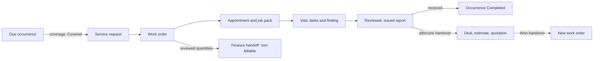

# TS-02 — Berry farm planned maintenance

| Field | Value |
| --- | --- |
| Title and ID | Berry farm planned maintenance — TS-02 (PPO-TS-02) |
| Type | Test specification (end-to-end business scenario) |
| Status | Draft |
| Owner | Dean Fiedler, prototype owner |
| Review | Not yet reviewed |
| Scope | Powerplants One prototype: Maintenance, Service, Field, Reports, Sales aftercare, CRM, Estimating, Finance |
| Repository path | `docs/testing/TS-02-berry-farm-planned-maintenance.md` |
| Versioning | Living specification under PPO-STD-001 section 7.1: Git history, no rNN suffix |
| Sources | [TS-01](TS-01-berry-farm-fertigation-project.md) stage 15; BP-01 section 6.3 (journey J-02); `docs/testing/acceptance-scenarios.csv`; `docs/delivery/maintenance-warranty-handover.md` |

Change record: r01 draft prepared 30 October 2026 at Dean's request, following TS-01's structure, from a reading of main at `fa15714`.

## 1. Purpose and scope

TS-02 tests one planned maintenance service from its due date to Finance, and the sales follow-up a field finding creates. It continues TS-01: Bellbird Ridge Berries' maintenance agreement is Active and three quarterly services were generated in TS01-15.05. The first, due 12 June 2027, finds a worn dosing pump.

**What it tests**

- A due occurrence becoming owned work only after coverage is assessed, and once only.
- Replaying maintenance generation without duplicating an occurrence (AT-19, AT-33).
- A visit that completes its planned tasks while a finding stays open (AT-14).
- Coverage of a found problem decided separately from the service it was found on.
- A field finding reaching Sales through an aftercare handover, then becoming a quote (AT-25).
- Covered labour and parts reaching Finance as non-billable, with a reason.

**What it does not test**

- The replacement visit after the quote is won; that belongs to a later scenario.
- Warranty claims and supplier recovery (TS-05) and breakdowns (TS-04).
- Agreement invoicing: the $4,800.00 annual fee has no PPO billing path today (finding F2-05).

**How to use it**

Use TS-01's method (TS-01 section 1): run stages in order as the named profile, record every step in the run's results log, run branches on a copy, and stop on a failed step that later steps depend on. Step IDs take the form TS02-04.03; branches TS02-X01.

## 2. Scenario narrative

Bellbird's fertigation system has run for three months when its first quarterly service falls due on Saturday 12 June 2027. All people, places and figures are fictional.

1. On Friday 14 May 2027 the Coordinator works through upcoming maintenance, confirms the service is covered by the agreement, and raises the work.
2. Riley is booked for Tuesday 15 June. Priya confirms site readiness on Thursday 10 June, and the job pack is issued and acknowledged.
3. On the visit Riley completes the four planned tasks. Channel B's dosing pump delivers only 62% of its rated flow: the diaphragm is worn. He records it as a finding needing follow-up.
4. The report is reviewed and issued, and Priya accepts it. The service is recorded as completed against the due occurrence.
5. The worn diaphragm is assessed as not covered: the agreement excludes dosing pump diaphragms and repair kits.
6. Service hands the finding to Sales through an aftercare review. Sales opens a deal for a pump repair kit, quotes $1,510.00 ex GST, and Priya accepts on Friday 25 June. The deal is Won and handed to Service.
7. Finance receives the maintenance visit's labour and parts as non-billable, covered by the agreement, and reconciles them. A renewal review is set up for December.

## 3. Synthetic data set

**Carried over from TS-01**

| Record | Value |
| --- | --- |
| Customer and site | Bellbird Ridge Berries — Synthetic; Bellbird Ridge farm — Synthetic |
| Site contact | Priya Nandakumar (synthetic), primary site contact |
| Agreement | `SYN-AGR-…` from TS01-15.02, Active, 12 March 2027 to 11 March 2028; exclusions "Wear parts beyond one filter element per visit, including dosing pump diaphragms and repair kits" |
| Plan | `SYN-MPL-…` from TS01-15.04, Quarterly, anchor 12 March 2027, for the fertigation unit asset |
| Occurrences | 12 June, 12 September and 12 December 2027, Open |

**Plan tasks.** The work order's scope task descriptions must match these exactly, or the result cannot be received against the occurrence.

| Task | Kind | Description (exact text) |
| --- | --- | --- |
| T1 | Intervention | Inspect and clean the inlet filter; replace the element if more than half blocked |
| T2 | Inspection | Check EC and pH sensors against reference solutions; recalibrate if drift exceeds 0.1 |
| T3 | Inspection | Measure each dosing channel's flow against its rated output |
| T4 | Intervention | Back up the process computer configuration and test the high-EC alarm |

**Field readings Riley records**

| Reading | Value | Unit | Result |
| --- | --- | --- | --- |
| EC sensor drift against 1.41 reference | 0.04 | mS/cm | Within tolerance |
| pH sensor drift against 7.00 reference | 0.06 | pH | Within tolerance |
| Channel A flow | 98 | % of rated | Pass |
| Channel B flow | 62 | % of rated | Finding: worn diaphragm |
| Channel C flow | 96 | % of rated | Pass |
| Acid channel flow | 99 | % of rated | Pass |

Field time is scaled as in TS-01 section 5: 3 scenario hours are recorded as 3 minutes. One filter element is used, covered by the agreement.

**Replacement quote (price fixture)**

| # | Line | Qty | Unit | Unit price ex GST | Total ex GST |
| --- | --- | --- | --- | --- | --- |
| 1 | Dosing pump repair kit, channel B | 1 | each | $1,240.00 | $1,240.00 |
| 2 | Fitting labour | 2 | hour | $135.00 | $270.00 |
| | Total | | | | $1,510.00 |
| | GST 10% | | | | $151.00 |
| | Total inc GST | | | | $1,661.00 |

Calculated outside PPO; synthetic, not Powerplants or Priva prices. Totals are a pass criterion only once the fixture is signed off (TS-01 Q3).

**Key dates**

| Date | Event |
| --- | --- |
| Friday 14 May 2027 | Coverage assessed for the 12 June occurrence |
| Monday 17 May 2027 | Service request raised; work order authorised |
| Wednesday 19 May 2027 | APT booked for Tuesday 15 June |
| Thursday 10 June 2027 | Site readiness confirmed |
| Friday 11 June 2027 | Job pack issued and acknowledged |
| Tuesday 15 June 2027 | Service visit |
| Wednesday 16 June 2027 | Report reviewed and issued; Priya accepts it |
| Thursday 17 June 2027 | Result received on the occurrence; generation replayed; pump coverage assessed |
| Friday 18 June 2027 | Aftercare handover; deal opened |
| Monday 21 June 2027 | Quotation issued |
| Friday 25 June 2027 | Priya accepts; deal Won; handed to Service |
| Monday 28 June 2027 | Finance handoff for the maintenance visit; renewal review set up |
| Monday 13 December 2027 | Renewal review window begins |

Events are recorded at run time with the scenario date in notes (TS-01 section 5, time compression). Planned dates that PPO only stores use the scenario dates.

## 4. Actors

Use the TS-01 section 4 profiles. TS-02 adds no profile.

| Role | Profile | Duties exercised |
| --- | --- | --- |
| Maintenance coordinator, scheduler, report reviewer, Sales | Coordinator | `maintenance.manage`, `maintenance.assess`, `service.ticket.edit`, `service.work_order.edit`, `service.scope.authorise`, `schedule.*`, `pack.*`, `report.review`, `report.issue`, `shared.history.record`, `crm.opportunity.create` |
| Technician | Riley — assigned technician | `field.*.own`, `pack.acknowledge`, `report.respond` |
| Estimate reviewer; quotation approver and issuer | Synthetic source evidence reviewer; Synthetic quotation approver; Synthetic quotation issuer | As TS-01 stages 4–5 |
| Finance | Finance preparer, Finance reviewer, Finance processor, Finance reconciler | `finance.*` |
| Negative cases | Morgan — assigned technician (not on this visit); Observer; Finance reviewer for manage actions | Must be refused (branches) |

## 5. Preconditions

- TS-01 environment (section 5) and TS-01 stage 15 exit criteria met, or the same records created directly through the screens.
- PR #750 (P4 site readiness) merged, or stage 3's dispatch expectation recorded as held (TS-01 finding F-08).
- The three occurrences from TS01-15.05 exist and are Open.

## 6. Stage-by-stage steps

A finding leaves the visit two ways: the occurrence is completed from the reviewed report, and the open finding reaches Sales through aftercare.

### Stage 1 — Coverage assessed for the first occurrence (14 May 2027)

**Entry criteria:** preconditions met.

| Step | Profile | Page | Action | Pass when | If it fails |
| --- | --- | --- | --- | --- | --- |
| TS02-01.01 | Coordinator | `/maintenance/due` | Find the 12 June 2027 occurrence for Bellbird | One Open occurrence `SYN-MOC-…` with original due 12 June 2027 and the fertigation unit asset | S2; stop |
| TS02-01.02 | Coordinator | `/maintenance/due/[id]` | Try Prepare owned Service request before any coverage assessment | Refused: an exact Covered assessment is required | S1 if a request is created |
| TS02-01.03 | Coordinator | `/maintenance/coverage` | Create assessment: Bellbird, site, fertigation unit, the exact agreement revision, event date 12 June 2027, determination Covered, cause "Planned service under agreement", evidence "Agreement scope: quarterly fertigation and controller service" | Assessment `SYN-ENT-…` Covered, dated to the original due | S2; stop |

**Exit criteria:** a Covered assessment exists for the occurrence's original due date.

**Links:** `src/maintenance/assessments.ts`; AT-19. Branch TS02-X01.

### Stage 2 — Service request and work order (17 May 2027)

**Entry criteria:** stage 1 exit met.

| Step | Profile | Page | Action | Pass when | If it fails |
| --- | --- | --- | --- | --- | --- |
| TS02-02.01 | Coordinator | `/maintenance/due/[id]`, Decisions & handovers | Prepare owned Service request, choosing the stage 1 assessment and Coordinator as owner, with a reason | Request `SYN-TKT-…` New, channel PlannedMaintenance, summary "Maintenance request · SYN-MOC-…"; occurrence WorkRequested | S2; stop |
| TS02-02.02 | Coordinator | `/maintenance/due/[id]` | Try Prepare owned Service request again; then try Defer original occurrence | Both refused: one request per occurrence, and no defer once work is requested | S1 if a second request is created |
| TS02-02.03 | Coordinator | `/service/tickets/[id]` | Triage the request | Triaged | S3; continue |
| TS02-02.04 | Coordinator | `/service/work-orders/new` | Create the work order from the request: one scope item per plan task T1–T4 with the exact section 3 text, the fertigation unit bound to the scope, coverage block naming the agreement and the stage 1 assessment | Work order `SYN-WO-…` Draft; coverage shows the agreement and assessment | S2; stop |
| TS02-02.05 | Coordinator | `/service/work-orders/[id]` | Authorise | Authorised | S2; stop |

**Exit criteria:** occurrence WorkRequested; one request; work order Authorised with T1–T4.

**Links:** `src/maintenance/receiving.ts`; PT-04, PT-05. Branches TS02-X02, TS02-X03.

### Stage 3 — Booking, site readiness and job pack (19 May – 11 June 2027)

**Entry criteria:** stage 2 exit met.

| Step | Profile | Page | Action | Pass when | If it fails |
| --- | --- | --- | --- | --- | --- |
| TS02-03.01 | Coordinator | `/schedule` | Propose and confirm the visit for Riley (scenario Tuesday 15 June, 08:00–11:00) | Appointment `SYN-APT-…` Confirmed | S2; stop |
| TS02-03.02 | Coordinator | `/service/appointments/[id]` | Record customer contact (dates agreed); then Record site readiness with all four checks Confirmed | Dates agreed; Customer site readiness Confirmed | S2; stop |
| TS02-03.03 | Coordinator | `/service/packs/new` | Prepare, check and issue the job pack with tasks T1–T4 | Pack `SYN-PACK-…` Issued naming Riley | S2; stop |
| TS02-03.04 | Riley — assigned technician | `/my-jobs/[id]` (phone) | Acknowledge this exact issue | Acknowledged; the appointment shows Ready to dispatch | S2; stop |

**Exit criteria:** appointment Confirmed and Ready to dispatch.

**Links:** AT-06, AT-07; PT-06. Branch TS02-X09.

### Stage 4 — Service visit with a finding (15 June 2027)

**Entry criteria:** stage 3 exit met; Riley on the phone viewport.

| Step | Profile | Page | Action | Pass when | If it fails |
| --- | --- | --- | --- | --- | --- |
| TS02-04.01 | Riley | `/my-jobs/[id]` | Start work | InProgress; timer Running | S2; stop |
| TS02-04.02 | Riley | `/my-jobs/[id]` | Record a Checklist result Pass for T1, and Material: one filter element | Entries saved; material shows 1 each | S2; continue |
| TS02-04.03 | Riley | `/my-jobs/[id]` | Record the six section 3 readings with values and units | Six Reading entries with units | S2; continue |
| TS02-04.04 | Riley | `/my-jobs/[id]` | Record an Observation: finding "Channel B dosing pump delivers 62% of rated flow; diaphragm worn", confidence Verified, follow-up required; add a photo | Observation saved with follow-up required; photo stored as PNG | S2; stop |
| TS02-04.05 | Riley | `/my-jobs/[id]` | Record time (3 minutes, standing for 3 hours); pause and resume once | Time entry saved; no overlap | S2; continue |
| TS02-04.06 | Riley | `/my-jobs/[id]` | Completion draft: T1–T4 each Complete; try overall outcome Complete | Overall Complete is refused because a follow-up is open; overall Partial is accepted | S1 if overall Complete is accepted |
| TS02-04.07 | Riley | `/my-jobs/[id]` | Submit exact evidence for review | Appointment CompletedPendingReview; an owned follow-up exists for the finding | S2; stop |

**Exit criteria:** visit submitted; tasks Complete; overall Partial; finding open with an owner.

**Links:** `src/field/completion.ts`; AT-12, AT-14; PT-13, PT-14. Branch TS02-X10.

### Stage 5 — Report reviewed, issued and accepted (16 June 2027)

**Entry criteria:** stage 4 exit met.

| Step | Profile | Page | Action | Pass when | If it fails |
| --- | --- | --- | --- | --- | --- |
| TS02-05.01 | Coordinator | `/service/reports/[id]` | Review the report: Approved | Reviewed; "Findings, attempted fixes and evidence" lists the readings, the observation and the checklist | S2; stop |
| TS02-05.02 | Coordinator | `/service/reports/[id]` | Issue the report | Report `SYN-RPT-…` Issued; customer copy has no internal notes | S1 if internal notes show |
| TS02-05.03 | Coordinator | `/service/reports/[id]` | Record Priya's response: Accepted | Response recorded against the exact issued version | S2; continue |

**Exit criteria:** report Issued and Accepted.

**Links:** AT-13; PT-15, PT-16.

### Stage 6 — Occurrence completed; generation replayed (17 June 2027)

**Entry criteria:** stage 5 exit met.

| Step | Profile | Page | Action | Pass when | If it fails |
| --- | --- | --- | --- | --- | --- |
| TS02-06.01 | Coordinator | `/maintenance/due/[id]` | Receive exact reviewed Service result: the original work request, the reviewed report revision, and T1–T4 mapped Complete | Occurrence Completed. A Partial overall visit still completes the occurrence, because every mapped task is Complete | S2; stop |
| TS02-06.02 | Coordinator | `/maintenance/plans/[id]` | Generate bounded due occurrences again for 13 March 2027 to 11 March 2028 | No occurrence created; history lists all three as retained; the June occurrence stays Completed | S1 if duplicated or reopened |
| TS02-06.03 | Coordinator | `/maintenance/plans/[id]` | Try to generate 13 March 2027 to 12 June 2028 | Refused for dates past the agreement term ("An ungenerated date needs current agreement terms…"); nothing is created | S1 if a date past expiry is created |
| TS02-06.04 | Coordinator | `/maintenance/due` | Check the remaining occurrences | 12 September and 12 December 2027 Open | S2; continue |

**Exit criteria:** June occurrence Completed; no duplicates; nothing past the term.

**Links:** AT-19, AT-33. Branch TS02-X04.

### Stage 7 — Coverage of the worn pump (17 June 2027)

**Entry criteria:** stage 6 exit met.

| Step | Profile | Page | Action | Pass when | If it fails |
| --- | --- | --- | --- | --- | --- |
| TS02-07.01 | Coordinator | `/maintenance/coverage` | Create assessment for the fertigation unit, event date 15 June 2027: determination NotCovered; cause "Diaphragm wear in normal use"; evidence: the agreement exclusion and the issued report | Assessment `SYN-ENT-…` NotCovered, with cause recorded separately from coverage | S2; continue |
| TS02-07.02 | Coordinator | `/maintenance/coverage` | Open the stage 1 assessment | Still Covered for 12 June; the new assessment does not replace it, because it is for a different event | S1 if the stage 1 assessment changes |

**Exit criteria:** the repair is recorded as not covered, with reason and evidence.

**Links:** AT-19. Branch TS02-X05.

### Stage 8 — Aftercare to a deal (18 June 2027)

**Entry criteria:** stage 7 exit met.

| Step | Profile | Page | Action | Pass when | If it fails |
| --- | --- | --- | --- | --- | --- |
| TS02-08.01 | Coordinator | `/sales/aftercare` | Select the issued report; Open aftercare review | Aftercare record Open, owned by Coordinator | S2; stop |
| TS02-08.02 | Coordinator | `/sales/aftercare/[id]`, Maintenance & renewal | Check that the agreement and remaining occurrences are shown; Prepare commercial discussion: observation and evidence from the report, need "Restore channel B dosing accuracy", assumption "Repair kit, not a new pump", and confirm existing opportunities were reviewed | Discussion saved; the existing TS-01 deal is listed as reviewed, not reused | S2; stop |
| TS02-08.03 | Coordinator | `/sales/aftercare/[id]` | Prepare exact handover; Submit exact handover, receiving owner Coordinator | Handover submitted with time | S2; stop |
| TS02-08.04 | Coordinator | `/sales/opportunities/new` | Create deal "Bellbird — channel B dosing pump repair" for the same organisation, site and company | Deal `SYN-OPP-…` at Discovery | S2; stop |
| TS02-08.05 | Coordinator | `/sales/aftercare/[id]` | Record receiving outcome Accepted, linking the new deal | Accepted; the aftercare record links the deal | S2; stop |

**Exit criteria:** one new deal, linked to the aftercare record and the issued report.

**Links:** `src/sales/aftercare-service.ts`; AT-25. Branch TS02-X06.

### Stage 9 — Quotation, acceptance and Won handover (21–25 June 2027)

**Entry criteria:** stage 8 exit met.

| Step | Profile | Page | Action | Pass when | If it fails |
| --- | --- | --- | --- | --- | --- |
| TS02-09.01 | Coordinator | `/sales/opportunities/[id]` | Create estimate; enter the two section 3 lines | Estimate `SYN-EST-…` at $1,510.00 ex GST; any GST shown separately at $151.00 | S1 once Q3 signs off the fixture; S3 until then |
| TS02-09.02 | Synthetic source evidence reviewer | `/estimating/estimates/[id]/review` | Record the three reviews | Estimate Reviewed | S2; stop |
| TS02-09.03 | Coordinator, approver, issuer | `/estimating/quotes/[id]/release` | Prepare, approve, issue | Quotation `SYN-QUO-…` Issued; distribution simulated | S2; stop |
| TS02-09.04 | Coordinator | `/estimating/quotes/[id]/response` | Record Priya's response: Accepted, no conditions | Accepted against the exact issue | S2; stop |
| TS02-09.05 | Coordinator | `/sales/opportunities/[id]` | Move the deal forward one stage at a time to Closing; Record outcome Won with the accepted response as evidence | Won | S2; stop |
| TS02-09.06 | Coordinator | `/sales/handoffs/won` | Prepare and submit the Won handover, destination Service; accept it as Service; create the work order from it | Handover Accepted; new work order `SYN-WO-…` Draft for the repair, separate from the maintenance work order | S1 if the maintenance work order is changed |

**Exit criteria:** deal Won; repair work order Draft. The repair visit is out of scope.

**Links:** `docs/contracts/quotation-release.md`; AT-03, AT-05.

### Stage 10 — Finance and renewal set-up (28 June 2027)

**Entry criteria:** stage 9 exit met.

| Step | Profile | Page | Action | Pass when | If it fails |
| --- | --- | --- | --- | --- | --- |
| TS02-10.01 | Finance preparer | `/finance/handoffs/new` | Create the handoff for the maintenance work order from the issued report; mark the 3-minute time line and the filter element NonBillable, reason "Covered by agreement SYN-AGR-…"; Submit | ReadyForReview; quantities equal the reviewed report; nothing becomes NonBillable without the preparer's choice (finding F2-03) | S1 if a quantity differs |
| TS02-10.02 | Finance reviewer | `/finance/handoffs/[id]` | Approve | Approved | S2; stop |
| TS02-10.03 | Finance processor | `/finance/handoffs/[id]` | Claim processing; record the simulated ERP outcome Finance chooses for an all non-billable handoff (Processed or NotProcessed), and record which PPO offers | AwaitingERP, then the recorded outcome with its evidence | S2; stop |
| TS02-10.04 | Finance reconciler | `/finance/handoffs/[id]` | Reconcile | Matched or NoPostingRequired; Reconciled | S2; stop |
| TS02-10.05 | Coordinator | `/maintenance/renewals` | Create renewal review: the agreement revision, the site, owner Coordinator, window begins 13 December 2027, next action "Review renewal with Graham" | Renewal review `SYN-REN-…` in Review | S2; continue |
| TS02-10.06 | Coordinator | `/maintenance/renewals/[id]` | Create CRM relationship Activity; then try it again | One Activity created; the second attempt creates none | S1 if duplicated |
| TS02-10.07 | Coordinator | `/customers/[id]` | Open Bellbird's customer record | History now adds the maintenance request, visit, issued report, aftercare record, repair deal and quotation to TS-01's records | S2 if any record is missing |

**Exit criteria:** maintenance handoff Reconciled; renewal review in place; one continuous customer history.

**Links:** `docs/contracts/finance-handoff.md`; `src/maintenance/renewals.ts`; AT-12, AT-25, AT-33; PT-17.

## 7. Exception and negative tests

| ID | Branch from | Trigger | Pass when | Links |
| --- | --- | --- | --- | --- |
| TS02-X01 | TS02-01.03 | Create the assessment dated 15 June (the visit date) instead of 12 June (the original due), then Prepare owned Service request | Refused: the assessment must be dated to the occurrence's original due | AT-19 |
| TS02-X02 | TS02-02.01 | Two browser sessions press Prepare owned Service request at the same time | One request; the other attempt is refused or returns the same receipt | AT-05 |
| TS02-X03 | TS02-02.04 | Word T3 differently on the work order ("Check dosing flow") | Receiving the result in TS02-06.01 is refused for the unmatched task; nothing is completed | AT-14 |
| TS02-X04 | TS02-06.01 | Before receiving the result, relocate the fertigation unit to another site | Prepare and receive actions refused; the plan becomes ReviewRequired | AT-33 |
| TS02-X05 | TS02-07.01 | Record the pump as Disputed instead of NotCovered | Disputed requires a review due date and keeps the decision open with a next action | AT-19 |
| TS02-X06 | TS02-08.05 | Record receiving outcome Accepted, linking the TS-01 deal created before the handover | Refused: the deal must be created after the submission | AT-25 |
| TS02-X07 | TS02-09.04 | Priya declines the quotation | Response Declined; the deal can be recorded Lost with a reason; the aftercare record keeps its link | AT-25 |
| TS02-X08 | Any stage 1–2 or 6–7 | Finance reviewer tries to create a plan or an assessment; Coordinator tries to approve the agreement | Each refused for a missing duty | AT-01 |
| TS02-X09 | TS02-03.04 | Morgan — assigned technician (not on this visit) opens the visit and the inspection page | Refused without leaking details | AT-01, AT-34 |
| TS02-X10 | TS02-04.06 | Riley records T3 as Partial instead of Complete | The occurrence is received as Partial, not Completed, and stays open | AT-14 |
| TS02-X11 | TS02-10.02 | Finance reviewer tries to approve with a line still Pending | Refused until every line is Billable or NonBillable | AT-12 |

## 8. Build coverage and findings

All 10 stages are testable in PPO today, given PR #750 for stage 3's dispatch result. These findings come from reading main at `fa15714`; they are not test results.

| ID | Finding | Effect on TS-02 | Source |
| --- | --- | --- | --- |
| F2-01 | Turning an occurrence into work creates only a service request; the work order is built by hand, and its task text must match the plan exactly | A typing difference blocks receiving the result (TS02-X03) | `src/maintenance/receiving.ts` |
| F2-02 | No worker generates occurrences or renewal reviews; both are created by hand | Missed generation or renewal depends on people remembering | `src/maintenance/plans.ts`, `src/maintenance/renewals.ts` |
| F2-03 | Nothing defaults agreement-covered lines to NonBillable | Finance sets each line by hand | `src/finance/validation.ts` |
| F2-04 | No fertigation inspection template exists, and the findings register page is not built (API only) | Readings and the finding are recorded as visit captures, not a structured inspection | `src/inspections/service.ts`; `/api/v1/service/findings` |
| F2-05 | Agreements hold price only as free text, with no invoicing path | The $4,800.00 annual fee cannot reach Finance through PPO | `src/maintenance/agreements.ts` |
| F2-06 | Occurrences, assessments, plans and renewals use `SYN-<KIND>-` plus 12 UUID characters, not the counter references other records use | References look different from TS-01's | `src/maintenance/context.ts` |

TS-01 findings F-10 (no install or warranty dates on the equipment form), F-11 (no creator check on agreements or plans) and F-12 (no six-monthly interval) also apply.

## 9. Traceability

| Stage | AT cases | PT and other | Sources |
| --- | --- | --- | --- |
| 1–2 Coverage and work | AT-05, AT-19 | PT-04, PT-05 | `src/maintenance/receiving.ts` |
| 3–5 Visit and report | AT-06, AT-07, AT-12, AT-13, AT-14 | PT-06, PT-13–PT-16 | Field readiness gate; SV-04 |
| 6–7 Occurrence and coverage | AT-19, AT-33 | `tests/database/maintenance.test.ts` (MA03/04) | `docs/delivery/maintenance-warranty-handover.md` |
| 8–9 Aftercare and quote | AT-03, AT-05, AT-25 | — | `src/sales/aftercare-service.ts`; `docs/contracts/quotation-release.md` |
| 10 Finance and renewal | AT-12, AT-25, AT-33 | PT-17 | `docs/contracts/finance-handoff.md` |
| Exceptions | AT-01, AT-34 | — | — |

A TS-02 pass marks no AT or PT case passed.

## 10. Evidence, defects and pass rule

As TS-01 section 10: same evidence standard, severity scale (S1–S4) and outcome rules. The results log is `docs/testing/evidence/ts-02/TS-02-run-<UTC timestamp>-01.md`, one row per step and branch (46 steps and 11 branches, 57 rows).

## 11. Open questions for Dean

| ID | Question | Recommendation |
| --- | --- | --- |
| Q1 | Powerplants services fertigation every six months, but PPO offers only monthly or quarterly plans. Add six-monthly (and yearly)? | Yes: a small model change with high value; TS-01 and TS-02 move back to six-monthly when it lands |
| Q2 | Should turning a due occurrence into work also create the work order, with the plan's tasks copied in? | Yes: it removes the exact-text trap (F2-01) |
| Q3 | Should agreement-covered lines default to NonBillable with the agreement as the reason, as decided for project work orders? | Yes, matching PR #751's rule R3 |
| Q4 | How is the annual agreement fee invoiced? | A small decision paper alongside PR #751's milestone claims |
